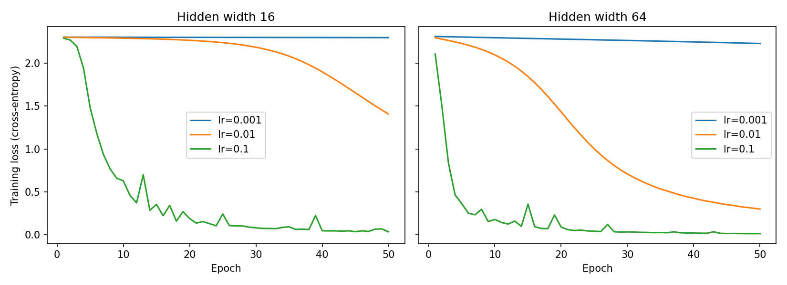

# Lab 2: Neural Network from Scratch

## 1. Goal

The goal of this lab was to implement a fully connected neural network from scratch using Python and NumPy, without relying on a deep-learning framework for the network's forward propagation, backpropagation, or parameter updates. The network was designed to classify handwritten digits into 10 classes.

The lab focused on implementing and testing the neural network, verifying the correctness of its gradients, measuring computational performance, and investigating how hidden-layer width and learning rate affect training and test performance.

## 2. Method

### Network architecture

I implemented a fully connected neural network with 64 input features, two hidden layers, and an output layer containing 10 units, one for each digit class. The width of both hidden layers was varied between 16 and 64 neurons.

The network was implemented using NumPy. Forward propagation calculates the activations at each layer, and the output layer uses softmax to produce probabilities for the 10 classes. Cross-entropy loss measures the difference between the predicted probabilities and the true labels.

Backpropagation calculates the gradients of the loss with respect to the weights and biases using the chain rule. The parameters are then updated using gradient descent.

The weight initialization followed the specified normal distribution, \(N(0, 0.01)\), interpreted as a distribution with mean 0 and variance 0.01 (standard deviation 0.1).

### Experimental setup

I tested two hidden-layer widths (16 and 64) and three learning rates (0.001, 0.01, and 0.1). Each configuration was trained for 50 epochs. Training loss, test loss, and test accuracy were recorded throughout training to compare the performance of the six configurations.

I also performed sanity checks on the output probabilities and initial loss, used numerical gradient checking to validate backpropagation, and measured the forward- and backward-pass execution times.

## 3. Results

### Final model performance

The following table shows the training loss, test loss, and test accuracy after 50 epochs.

| Hidden width | Learning rate | Train loss | Test loss | Test accuracy |
|---:|---:|---:|---:|---:|
| 16 | 0.001 | 2.2976 | 2.2983 | 18.33% |
| 16 | 0.01 | 1.4072 | 1.4214 | 63.15% |
| 16 | 0.1 | 0.0342 | 0.1534 | 95.56% |
| 64 | 0.001 | 2.2291 | 2.2314 | 35.93% |
| 64 | 0.01 | 0.3002 | 0.3354 | 92.04% |
| 64 | 0.1 | 0.0145 | 0.1145 | 96.67% |

The best final test accuracy was **96.67%**, achieved with a hidden width of 64 and a learning rate of 0.1. This configuration also achieved the lowest final test loss, approximately 0.1145.

The learning rate had a substantial effect on performance. With a learning rate of 0.001, both networks learned slowly and retained relatively high losses. Increasing the learning rate to 0.01 improved the results considerably, particularly for the wider network. A learning rate of 0.1 produced the best final results for both widths.

### Sanity checks

The output probability and initial-loss checks produced the following results.

| Hidden width | Output shape | Maximum row-sum error | Initial loss | \(\ln(10)\) |
|---:|---|---:|---:|---:|
| 16 | (1257, 10) | \(3.33 \times 10^{-16}\) | 2.3032 | 2.3026 |
| 64 | (1257, 10) | \(3.33 \times 10^{-16}\) | 2.3128 | 2.3026 |

The output shape was correct for 1,257 training samples and 10 classes. The row-sum error was extremely small, confirming that the softmax probabilities summed to approximately one for each sample. The initial losses were also close to \(\ln(10)\), the expected cross-entropy loss for approximately uniform predictions across 10 classes.

### Gradient checking

I performed numerical gradient checks on 10 randomly selected weight elements for each hidden-layer width. The analytical gradients calculated by backpropagation were compared with numerical gradients estimated using finite differences.

| Hidden width | Gradients checked | Passed | Maximum relative error |
|---:|---:|---:|---:|
| 16 | 10 | 10 | \(2.74 \times 10^{-8}\) |
| 64 | 10 | 10 | \(2.89 \times 10^{-7}\) |

All 20 gradient checks passed. Both maximum relative errors were below the chosen tolerance of \(10^{-6}\). The close agreement between analytical and numerical gradients supports the correctness of the implemented backpropagation calculations for the tested parameters.

### Execution-time measurements

The measured execution times for the forward and backward passes are shown below.

| Hidden width | Forward pass (µs) | Backward pass (µs) | Backward/forward ratio |
|---:|---:|---:|---:|
| 16 | 654.70 | 621.65 | 0.95 |
| 64 | 408.15 | 410.20 | 1.01 |

The measured backward-to-forward ratios were 0.95 for width 16 and 1.01 for width 64. In these measurements, the backward pass took approximately the same time as the forward pass.

Unexpectedly, the width-64 network was measured as faster than the width-16 network. These results should therefore be interpreted cautiously: execution time can be affected by measurement overhead, NumPy and BLAS implementation details, and system-level variation. Repeated measurements under controlled conditions would be needed to draw a reliable conclusion about the effect of network width on execution time.

### Loss curves

The training and test loss curves across the six configurations provide a visual comparison of convergence and generalization.

The curves show the effect of learning rate on convergence. The learning rate of 0.001 resulted in slow progress, while 0.01 produced more substantial reductions in loss. The learning rate of 0.1 reduced the loss rapidly, although the training loss and test loss did not decrease smoothly at every epoch.

## 4. Three Conclusions

1. **The learning rate strongly affected training performance.** A learning rate of 0.001 was too small to achieve good classification performance within 50 epochs. Increasing it to 0.01 improved accuracy, while 0.1 produced the highest final test accuracy for both hidden-layer widths.

2. **Increasing hidden-layer width improved performance in these experiments.** The width-64 network achieved higher final test accuracy than the width-16 network at every tested learning rate. The best configuration, width 64 with a learning rate of 0.1, achieved 96.67% test accuracy and a test loss of 0.1145.

3. **Gradient checking supported the correctness of backpropagation, but the timing results require further investigation.** All 20 gradient checks passed with maximum relative errors below \(10^{-6}\). However, the measured execution times did not show the expected increase for the wider network. Repeated timing experiments would help determine whether this result came from measurement noise or implementation and system-level factors.