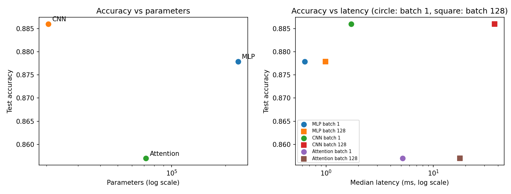

# Lab 3: Comparing MLP, CNN, and Attention Models

## Goal

The goal of this lab was to compare three neural network architectures for image classification: a Multilayer Perceptron (MLP), a Convolutional Neural Network (CNN), and an Attention-based model. The models were evaluated using parameter counts, computational cost (FLOPs), inference latency, and test accuracy. The experiment also compared manually calculated FLOPs with estimates from the `thop` library to understand the differences between theoretical calculations and tool-based measurements.

## Method

The experiment used the Fashion-MNIST dataset, which contains 28 × 28 grayscale images belonging to 10 clothing categories. The 60,000 training images were divided into 55,000 training samples and 5,000 validation samples. The remaining 10,000 images were used for testing.

All models used the same training configuration: Adam optimizer, learning rate of 0.001, batch size of 128, and five epochs. A random seed of 42 was used for reproducibility. The images were converted to tensors and normalized using a mean of 0.2860 and a standard deviation of 0.3530. Training and inference were performed on the CPU.

The MLP consisted of three fully connected layers with 256, 128, and 10 output units. The CNN used two convolutional layers with 16 and 32 filters, followed by max pooling and a fully connected classification layer. The Attention model divided each image into 16 patches of size 7 × 7, projected the patches into 64-dimensional embeddings, and processed them using two Transformer encoder layers with four attention heads. A learned positional embedding was added to preserve information about patch positions.

The parameter counts were obtained using `torchinfo`. Computational costs were calculated manually using the formulas from Chapter 4 and compared with estimates from `thop`. One multiply-add operation was counted as two FLOPs in the manual calculations. Since `thop` reports multiply-accumulate operations (MACs), its results were multiplied by two for comparison.

Inference latency was measured after one warm-up pass. Median latency was calculated over 100 runs with batch size 1 and 20 runs with batch size 128. The final test accuracy was measured using the separate test dataset.

The lab specifies a target of 100,000–150,000 parameters, but the prescribed architectures did not fall within this range. The MLP contained 235,146 parameters, the CNN contained 20,490, and the Attention model contained 71,818. The specified architectures were retained rather than modified. This mismatch should be clarified with the instructor.

### Hand-calculated FLOPs

The following calculations use the convention of two FLOPs per multiply-add.

**1. Linear layer (784 → 256)**

The formula for a fully connected layer is:

FLOPs = 2 × input units × output units

FLOPs = 2 × 784 × 256 = **401,408 FLOPs**

**2. Convolutional layer (16 → 32 filters, 3 × 3 kernel, 14 × 14 feature map)**

The formula is:

FLOPs = 2 × kernel height × kernel width × input channels × output channels × output height × output width

FLOPs = 2 × 3 × 3 × 16 × 32 × 14 × 14 = **1,806,336 FLOPs**

**3. Transformer encoder layer (sequence length 16, embedding dimension 64, feed-forward dimension 128)**

The total is calculated by adding the FLOPs for the Q, K, and V projections, attention scores, weighted sum of values, output projection, and feed-forward network.

- Q, K, V projections: 2 × 16 × 64 × 3 × 64 = 393,216 FLOPs
- Attention scores: 2 × 16 × 16 × 64 = 32,768 FLOPs
- Weighted sum of values: 2 × 16 × 16 × 64 = 32,768 FLOPs
- Output projection: 2 × 16 × 64 × 64 = 131,072 FLOPs
- Feed-forward network: 2 × 16 × 64 × 128 + 2 × 16 × 128 × 64 = 524,288 FLOPs

Total = 393,216 + 32,768 + 32,768 + 131,072 + 524,288 = **1,114,112 FLOPs**

These calculations cover the specified operations and do not include every operation in the models, such as activation functions, normalization, or softmax.

## Results

### Model comparison

| Model | Parameters | Hand FLOPs | `thop` MACs | `thop` FLOPs (×2) | Batch 1 latency (ms) | Batch 128 latency (ms) | Test accuracy |
|---|---:|---:|---:|---:|---:|---:|---:|
| MLP | 235,146 | 469,504 | 234,752 | 469,504 | 0.6357 | 0.9903 | 0.8779 |
| CNN | 20,490 | 2,063,488 | 1,031,744 | 2,063,488 | 1.7178 | 37.2665 | 0.8860 |
| Attention | 71,818 | 2,329,856 | 50,816 | 101,632 | 5.1734 | 17.6701 | 0.8570 |

The CNN achieved the highest test accuracy at 88.60%, followed by the MLP at 87.79% and the Attention model at 85.70%. The CNN also had the fewest parameters, with 20,490, while the MLP had the most, with 235,146.

The MLP had the lowest measured latency for both batch sizes. The CNN was slower than the other models at batch size 128, with a median latency of 37.2665 ms. The Attention model had a batch size 128 latency of 17.6701 ms, lower than the CNN's measured latency for that batch size.

The measured parameter counts also show that none of the three models met the required target range of 100,000–150,000 parameters.

### Layer-level FLOPs comparison

| Layer | Hand FLOPs | `thop` MACs | `thop` FLOPs (×2) | Hand / `thop` FLOPs |
|---|---:|---:|---:|---:|
| Linear 784 → 256 | 401,408 | 200,704 | 401,408 | 1.000 |
| Conv2d 16 → 32, 3 × 3, 14 × 14 | 1,806,336 | 903,168 | 1,806,336 | 1.000 |
| Transformer encoder layer, sequence length 16 | 1,114,112 | 0 | 0 | Undefined |

The linear and convolutional layer calculations matched the `thop` results after converting MACs to FLOPs by multiplying by two. However, `thop` returned zero MACs for the Transformer encoder layer. This shows that its default counting rules did not capture the relevant operations in this layer. The zero is a limitation of the measurement method, not evidence that the layer performs no computation.

The full Attention model had 50,816 reported MACs, equivalent to 101,632 FLOPs under the same conversion. This estimate is incomplete because it does not account for the encoder's matrix multiplications and other operations. Therefore, the manually calculated total of 2,329,856 FLOPs is more informative for the specified operations than the incomplete `thop` total.

### Trade-offs between accuracy, parameters, and latency

The following plot summarizes the relationship between parameter count, test accuracy, and measured latency.

The results show that the model with the most parameters was not the most accurate. The CNN achieved the highest test accuracy with only 20,490 parameters. This suggests that convolutional layers can use their shared filters to extract useful spatial features efficiently.

The MLP was the fastest model in the measured tests, but its fully connected layers required more parameters than the CNN. The Attention model had intermediate parameter requirements but achieved the lowest test accuracy in this experiment.

The latency results also depended on batch size. The CNN's batch size 128 latency was substantially higher than its batch size 1 latency, while the Attention model was faster than the CNN at batch size 128. These measurements illustrate that inference speed cannot be predicted from FLOPs alone. Memory access, implementation overhead, hardware utilization, and batch size can also affect latency.

### Cost-effectiveness

Cost-effectiveness depends on the balance between accuracy, computational cost, parameter count, and inference latency. The CNN produced the highest accuracy in this experiment while using the fewest parameters. Its convolutional filters reuse the same weights across different image locations, allowing the model to extract spatial patterns without requiring a separate weight for every input position.

The MLP was the fastest model in the measured latency tests, although it used considerably more parameters than the CNN. Its fully connected layers perform dense matrix operations, and their computational requirements increase with the number of input and output units.

The Attention model used more computation in the manual FLOPs calculation than either of the other models. Its self-attention mechanism calculates relationships between patches using a 16 × 16 attention-score matrix, followed by softmax and weighted-sum operations. These operations can be useful for modelling relationships between different image regions, but their benefits depend on the task and model configuration.

Arithmetic intensity and hardware utilization also affect the comparison. Processing larger batches can improve the reuse of weights and reduce some overhead per image, but it can also increase total execution time and memory requirements. The observed batch-size results show why both latency measurements should be considered rather than relying on theoretical FLOPs alone.

## Three conclusions

1. **The CNN provided the highest test accuracy with the fewest parameters.** It achieved 88.60% accuracy with 20,490 parameters, compared with 87.79% for the MLP and 85.70% for the Attention model. In this experiment, the CNN offered a strong balance between accuracy and model size.

2. **The FLOPs comparison depends on what the measurement tool counts.** The manually calculated FLOPs for the linear and convolutional layers matched the thop estimates after multiplying MACs by two. The Transformer encoder result was incomplete because thop reported zero MACs for the tested layer. This demonstrates the importance of understanding the limitations of profiling tools.

3. **Latency, accuracy, and parameter count measure different aspects of model performance.** The MLP had the lowest measured latency, while the CNN achieved the highest accuracy and used the fewest parameters. The Attention model was faster than the CNN at batch size 128 but had lower accuracy. Finally, none of the prescribed architectures met the stated 100,000–150,000 parameter target, so the architecture requirements should be clarified with the instructor.
